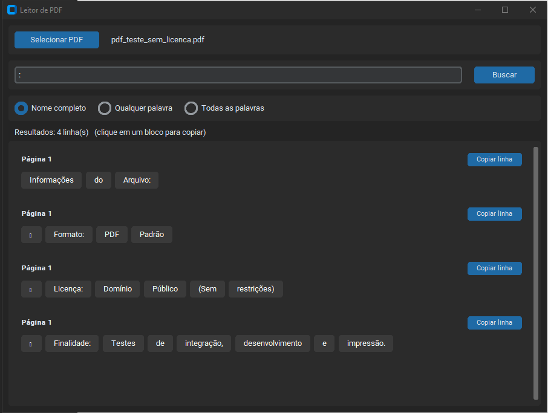

# Leitor de PDF — Busca por nome em tabelas

Aplicativo desktop em Python, com interface feita em [CustomTkinter](https://github.com/TomSchimansky/CustomTkinter), para **encontrar rapidamente a linha de uma tabela em um PDF a partir de um nome** (ex.: listas de aprovados, notas, classificações, chamadas).

Cada linha encontrada é exibida em um cartão, com **cada palavra separada em um bloco**, o que facilita ler as "colunas" da tabela e copiar só a informação que interessa.

<!-- Adicione um print da tela aqui:

-->

## Funcionalidades

- Seleção de qualquer arquivo PDF (botão ou `Ctrl+O`)
- Três modos de busca:
  - **Nome completo** – procura a frase exatamente como digitada
  - **Qualquer palavra** – linhas que contenham pelo menos um dos termos
  - **Todas as palavras** – linhas que contenham todos os termos, em qualquer ordem
- Busca **sem diferenciar maiúsculas/minúsculas nem acentos** (`jose` encontra `JOSÉ`)
- Resultados em blocos, com os termos buscados **destacados em azul**
- Clique em um bloco para **copiar** aquele valor, ou em **Copiar linha** para copiar a linha inteira
- Indica a **página** de cada resultado
- Limite de 200 resultados exibidos para não travar a interface em buscas muito genéricas
- Suporte a tema claro/escuro (segue o sistema)

## Como executar

Requer **Python 3.8+**.

```bash
# 1. Clone o repositório
git clone https://github.com/matheusbutyn/reconhecimento-palavras-pdf.git
cd <seu-repositorio>

# 2. (Opcional) Crie um ambiente virtual
python -m venv venv
venv\Scripts\activate        # Windows
# source venv/bin/activate   # Linux/macOS

# 3. Instale as dependências
pip install -r requirements.txt

# 4. Execute
python leitorPDF.py
```

## Como usar

1. Clique em **Selecionar PDF** e escolha o arquivo.
2. Digite o nome (ou parte dele) no campo de busca.
3. Pressione **Enter** ou clique em **Buscar**.
4. Clique em qualquer bloco para copiar o valor.

| Atalho   | Ação                     |
|----------|--------------------------|
| `Ctrl+O` | Abrir PDF                |
| `Enter`  | Buscar                   |
| `Esc`    | Limpar o campo de busca  |

## Limitações

- Funciona apenas com PDFs que **contêm texto**. PDFs escaneados (imagens) precisariam de OCR.
- O texto é extraído linha a linha pelo `pypdf`; em algumas tabelas as colunas podem vir "grudadas" ou uma célula com várias palavras pode virar vários blocos.

## Tecnologias

- [Python](https://www.python.org/)
- [CustomTkinter](https://github.com/TomSchimansky/CustomTkinter) – interface gráfica
- [pypdf](https://github.com/py-pdf/pypdf) – extração de texto do PDF (com fallback para `PyPDF2`)

